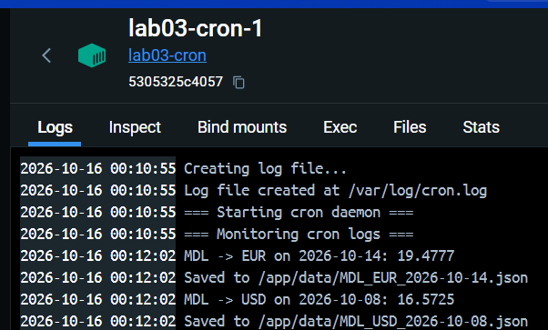

# Лабораторная работа №3

## Цель

Научиться настраивать планировщик cron для автоматического запуска скриптов.

## Структура

| Файл                        | Назначение                                                        |
|-----------------------------|-------------------------------------------------------------------|
| `currency_exchange_rate.py` | Скрипт из lab02: получает курс через API и сохраняет его в JSON   |
| `cronjob`                   | Задачи cron                                                       |
| `entrypoint.sh`             | Создаёт `/var/log/cron.log`, запускает cron и выводит лог         |
| `Dockerfile`                | Образ на `python:3.12-slim` с cron, `requests` и файлами выше     |
| `docker-compose.yml`        | Поднимает сервис курсов (`web`) и контейнер с cron (`cron`)       |
| `lab02prep/`                | Сервис курсов валют из lab02                                      |


## Задачи cron

```
0 6 * * *  ... MDL EUR $(date -d yesterday +\%F)
0 17 * * 5 ... MDL USD $(date -d '7 days ago' +\%F)
```

- Каждый день в 06:00: курс MDL → EUR за вчера.
- Каждую пятницу в 17:00: курс MDL → USD за тот же день неделю назад.

Знак `%` в crontab экранируется (`\%`), иначе cron считает его концом
команды. Вывод обеих задач дописывается в `/var/log/cron.log`. Время в
контейнере идёт по UTC.

## Сборка и запуск

```bash
cd lab03
docker compose up -d --build
```

Остановка:

```bash
docker compose down
```

## Проверка

Задачи установлены:

```bash
docker compose exec cron crontab -l
```

Лог cron (`entrypoint.sh` выводит его в логи контейнера):

```bash
docker compose exec cron cat /var/log/cron.log
docker compose logs -f cron
```

Сохранённые файлы:

```bash
docker compose exec cron ls /app/data
```

Чтобы не ждать 06:00 или пятницы, можно временно запускать задачи каждую
минуту, а потом вернуть расписание:

```bash
docker compose exec cron sh -c "sed 's/^0 [0-9]* \* \* [0-9*]/* * * * */' /app/cronjob | crontab -"
# подождать минуту
docker compose exec cron cat /var/log/cron.log
docker compose exec cron crontab /app/cronjob
```

## Результат

Проверка с запуском каждую минуту (2026-10-15 по UTC). Логи контейнера
`cron` в Docker Desktop, куда `entrypoint.sh` выводит `/var/log/cron.log`:



Курсы взяты за `2025-09-16`, это последняя дата в данных сервиса.

## Вывод

Cron в контейнере запускает скрипт по расписанию. Скрипт получает курс,
сохраняет его в `data/` и пишет вывод в `/var/log/cron.log`.
