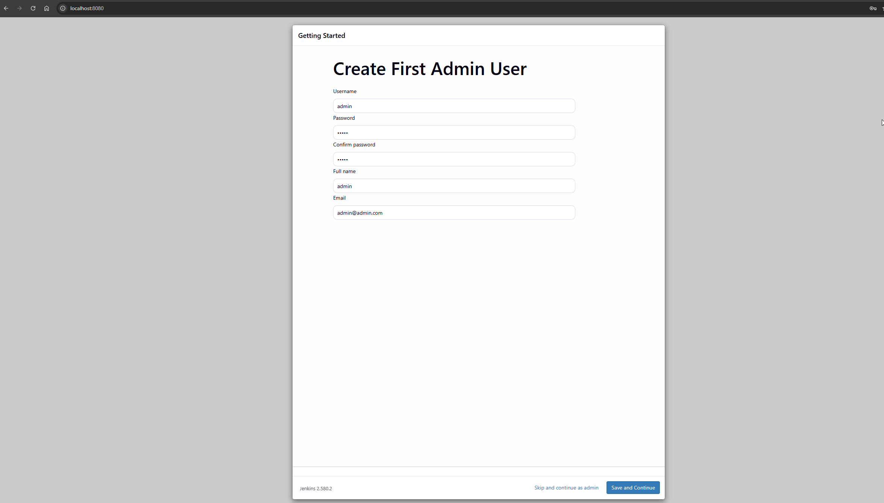
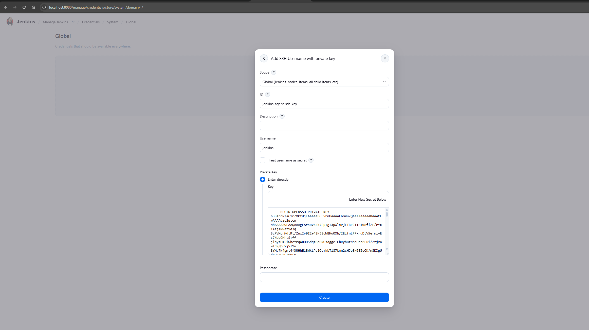
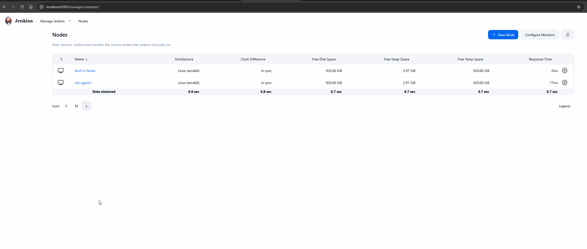
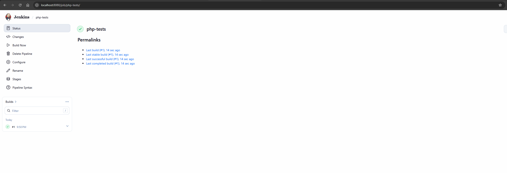

# Лабораторная работа №4

## Цель

Научиться настраивать Jenkins для автоматизации DevOps-задач: создавать
CI/CD-пайплайны и управлять ими.

## Описание проекта

В Docker Compose подняты два контейнера:

- `jenkins-controller` - сервер Jenkins с веб-интерфейсом.
- `ssh-agent` - агент Jenkins, к которому контроллер подключается по SSH.
  На агенте стоит PHP, на нём выполняются сборки.

Пайплайн проверяет PHP-проект из лабораторной №8 курса «Виртуализация и
контейнеризация»:
[usm-app-containerization/containers08](https://github.com/Caffadras/usm-app-containerization/tree/main/containers08).
Это сайт на PHP с SQLite. В нём есть классы `Database` и `Page` и 9 юнит-тестов
в `tests/tests.php`.

## Структура

| Файл                 | Назначение                                                    |
|----------------------|---------------------------------------------------------------|
| `docker-compose.yml` | Сервисы `jenkins-controller` и `ssh-agent`, тома и сеть        |
| `Dockerfile`         | Образ агента: `jenkins/ssh-agent` + `php-cli`, `php-sqlite3`, `sqlite3` |
| `Jenkinsfile`        | Пайплайн: подготовка проекта и запуск тестов                  |
| `.env.example`       | Пример файла `.env` с публичным ключом агента                 |
| `.gitignore`         | Не даёт добавить в git папку `secrets/` и файл `.env`         |
| `screenshots/`       | Скриншоты к отчёту                                            |

Папка `secrets/` и файл `.env` создаются локально и в репозиторий не попадают.
В `secrets/` лежит приватный ключ, его нельзя публиковать.

## Настройка Jenkins Controller

1. В `docker-compose.yml` описан сервис `jenkins-controller` на образе
   `jenkins/jenkins:lts`. Порт `8080` - веб-интерфейс, порт `50000` - для
   агентов, которые подключаются сами (inbound). Данные Jenkins хранятся в томе
   `jenkins_home`, поэтому они не пропадают при пересоздании контейнера.

2. Запуск:

   ```bash
   cd lab04
   docker compose up -d
   ```

3. Пароль для первого входа:

   ```bash
   docker exec jenkins-controller cat /var/jenkins_home/secrets/initialAdminPassword
   ```

4. На http://localhost:8080 ввести пароль, выбрать «Install suggested plugins»
   и создать пользователя-администратора.



## Настройка SSH-агента

1. Создать пару ключей:

   ```bash
   mkdir secrets
   cd secrets
   ssh-keygen -t rsa -b 4096 -f jenkins_agent_ssh_key
   ```

2. Записать публичный ключ в `.env`. Docker Compose читает этот файл сам и
   передаёт ключ в контейнер через переменную `JENKINS_AGENT_SSH_PUBKEY`.
   Образ `jenkins/ssh-agent` при старте кладёт его в `authorized_keys`
   пользователя `jenkins`.

   ```bash
   echo "JENKINS_AGENT_SSH_PUBKEY=$(cat secrets/jenkins_agent_ssh_key.pub)" > .env
   ```

3. `Dockerfile` агента:

   ```dockerfile
   FROM jenkins/ssh-agent

   RUN apt-get update && \
       apt-get install -y php-cli php-sqlite3 sqlite3 && \
       rm -rf /var/lib/apt/lists/*

   RUN mkdir -p /var/www/db && chown jenkins:jenkins /var/www/db
   ```

   - Кроме `php-cli` нужны `php-sqlite3` (драйвер PDO для SQLite) и `sqlite3`
     (чтобы создать базу из `schema.sql`). Без них тесты проекта не запустятся.
   - `rm -rf /var/lib/apt/lists/*` удаляет списки пакетов, которые скачал
     `apt-get update`. Они нужны только во время установки, а в образе
     занимали бы десятки мегабайт.
   - Папка `/var/www/db/` нужна, потому что `config.php` проекта ищет базу
     именно там. Сборка идёт под пользователем `jenkins`, поэтому папка
     отдаётся ему.

4. Пересобрать и перезапустить проект:

   ```bash
   docker compose up -d --build
   ```

5. Проверить, что вход по ключу работает. Для этого скопировать ключ в
   контроллер и зайти на агент:

   ```bash
   docker cp secrets/jenkins_agent_ssh_key jenkins-controller:/tmp/k
   docker exec -u root jenkins-controller chown jenkins /tmp/k
   docker exec jenkins-controller ssh -i /tmp/k jenkins@ssh-agent 'php --version'
   docker exec -u root jenkins-controller rm /tmp/k
   ```

### Подключение агента к Jenkins

1. **Manage Jenkins → Plugins → Installed plugins**: проверить, что стоит
   плагин «SSH Build Agents». Он входит в рекомендуемые плагины.

2. **Manage Jenkins → Credentials → System → Global credentials → Add
   Credentials**:
   - Kind: `SSH Username with private key`
   - ID: `jenkins-agent-ssh-key`
   - Username: `jenkins`
   - Private Key: «Enter directly»



3. **Manage Jenkins → Nodes → New Node**:
   - Node name: `ssh-agent1`, тип `Permanent Agent`
   - Remote root directory: `/home/jenkins/agent`
   - Labels: `php-agent`
   - Launch method: `Launch agents via SSH`
   - Host: `ssh-agent` (имя сервиса в сети Docker Compose)
   - Credentials: `jenkins (jenkins-agent-ssh-key)`
   - Host Key Verification Strategy: `Non verifying Verification Strategy`

4. После сохранения агент должен перейти в статус «online». Лог подключения
   виден в **Nodes → ssh-agent1 → Log**.



## Создание пайплайна

1. **New Item** → имя `php-tests` → тип **Pipeline**.
2. В разделе **Pipeline**:
   - Definition: `Pipeline script`
3. Сохранить и нажать **Build Now**.

`Jenkinsfile` состоит из двух этапов.

**Install Dependencies**:

- скачивает репозиторий с проектом командой `git`;
- копирует `tests/` внутрь `site/`. Так нужно, потому что `tests.php`
  подключает `../config.php`;
- удаляет старую базу и создаёт новую `/var/www/db/db.sqlite` из
  `sql/schema.sql`. Тесты меняют данные, поэтому каждая сборка начинает с
  чистой базы.

**Test**:

- запускает `php tests/tests.php`. Скрипт печатает итог вида `9 / 9`
  (пройдено / всего). Если пройдены не все тесты, он возвращает код 1, и
  Jenkins помечает этап как упавший.

Блок `post` выводит сообщение в конце: всегда, при успехе и при ошибке.



Фрагмент лога сборки:

```
[INFO] Running test Database connection
[INFO] Database connection successful
...
[INFO] Page render replaced all placeholders
9 / 9
Pipeline completed.
All stages completed successfully!
Finished: SUCCESS
```

## Ответы на вопросы

### Какие преимущества даёт Jenkins для автоматизации DevOps-задач?

- Бесплатный, с открытым кодом. Ставится на свой сервер, данные не уходят
  во внешний сервис.
- Пайплайн описан кодом в `Jenkinsfile`. Его хранят в git вместе с проектом,
  смотрят на ревью и откатывают, как обычный код.
- Больше 1800 плагинов: git, Docker, Kubernetes, уведомления, отчёты тестов и
  многое другое.
- Сборки можно раздать по агентам. Каждый агент настраивается под свою задачу
  (PHP, Java, Windows), и сборки идут параллельно.
- Запуск по событию: по коммиту, по расписанию, вручную, после другой сборки.
- История сборок, логи и результаты тестов хранятся в одном месте.

### Какие ещё бывают агенты Jenkins?

- **SSH-агент** - контроллер сам подключается к машине по SSH (как в этой
  работе).
- **Inbound-агент** (раньше JNLP) - агент сам подключается к контроллеру через
  порт `50000` или WebSocket. Удобно, если до агента нельзя достучаться
  снаружи, например он за NAT.
- **Docker-агент** - на каждую сборку создаётся контейнер из заданного образа
  и удаляется после неё (плагин Docker, или `agent { docker { ... } }` в
  `Jenkinsfile`).
- **Kubernetes-агент** - на каждую сборку в кластере создаётся pod (плагин
  Kubernetes).
- **Облачные агенты** - виртуальные машины в AWS EC2, Azure, Google Cloud.
  Создаются по мере нужды и удаляются, когда простаивают.
- **Встроенный узел** (built-in node) - сборка идёт прямо на контроллере. Так
  делать не советуют: сборка получает доступ к файлам контроллера.

### Какие проблемы возникли и как их решить?

1. **Тесты всегда завершались с кодом 0.** `tests.php` только печатал итог
   `N / M` и не возвращал ошибку. Jenkins показал бы успех даже при упавших
   тестах. Тот же баг был в GitHub Actions из лабораторной №8. Решение:
   исправлен сам проект. В `TestFramework` добавлен метод `isSuccess()`, а
   `tests.php` в конце вызывает `exit(1)`, если хотя бы один тест не прошёл.
   Проверено: на базе с лишней строкой тест `table count` падает, итог
   `8 / 9`, код выхода 1.

2. **Путь к базе зашит в `config.php`.** Проект рассчитан на Docker-образ, где
   база лежит в `/var/www/db/`. На агенте такой папки не было, а у
   пользователя `jenkins` нет прав создать её во время сборки. Решение: папка
   создаётся в `Dockerfile` агента и отдаётся пользователю `jenkins`.
   Пайплайн создаёт в ней новую базу на каждую сборку.

3. **В образе агента не было SQLite.** В `Dockerfile` из задания ставится
   только `php-cli`, без драйвера PDO для SQLite. Решение: добавить в
   `Dockerfile` пакеты `php-sqlite3` и `sqlite3`.

4. **Приватный ключ мог попасть в репозиторий.** Решение: `secrets/` и `.env`
   добавлены в `.gitignore`, а для примера лежит `.env.example`.
