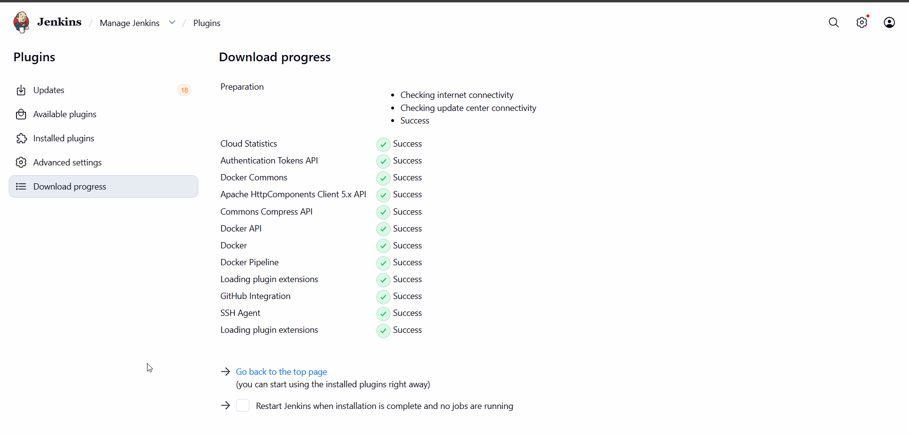
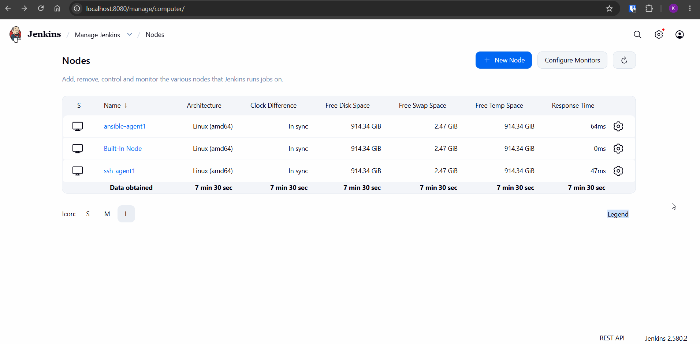
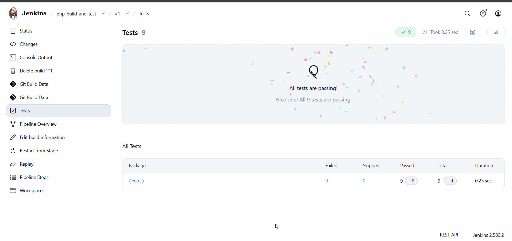
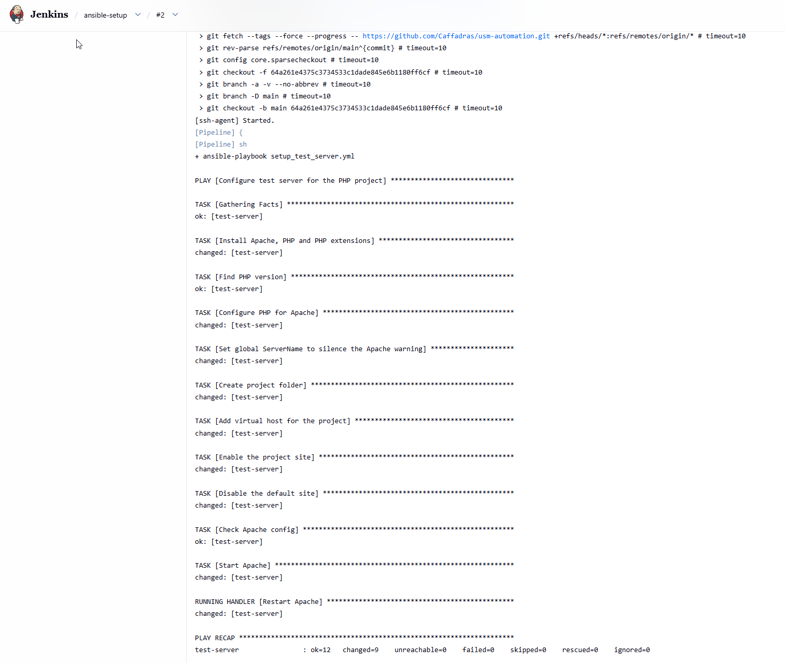
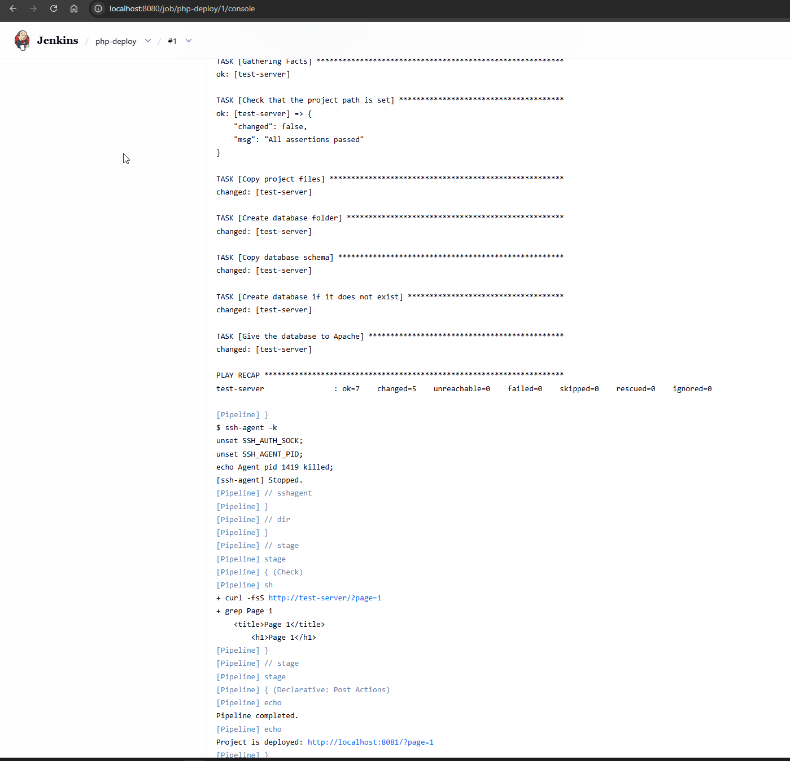
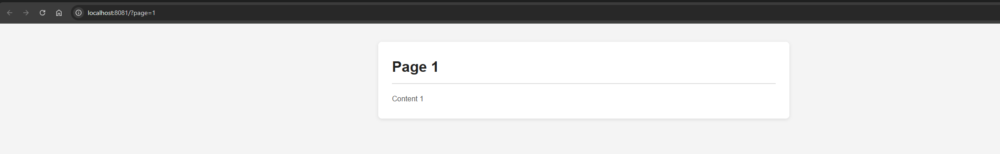

# Лабораторная работа №5

## Цель

Научиться писать Ansible playbook для автоматической настройки серверов.

## Описание проекта

Четыре контейнера в Docker Compose:

| Сервис               | Роль                                                       |
|----------------------|------------------------------------------------------------|
| `jenkins-controller` | Jenkins, управляет всеми пайплайнами                        |
| `ssh-agent`          | Агент Jenkins с PHP и Composer, собирает и тестирует проект |
| `ansible-agent`      | Агент Jenkins на Ubuntu с Ansible, настраивает сервер       |
| `test-server`        | Ubuntu с SSH, сюда Ansible ставит Apache и PHP и деплоит сайт |

```
jenkins-controller ──ssh──> ssh-agent
                   └─ssh──> ansible-agent ──ssh (ansible)──> test-server :80 → localhost:8081
```

PHP-проект: сайт на SQLite из лаб. №8,
[containers08](https://github.com/Caffadras/usm-app-containerization/tree/lab05-phpunit/containers08),
ветка `lab05-phpunit`. В этой ветке добавлены `composer.json` и 9 тестов на
PHPUnit (`tests/Unit/`).

## Структура

| Файл                         | Назначение                                     |
|------------------------------|------------------------------------------------|
| `compose.yaml`               | Все 4 сервиса                                  |
| `Dockerfile.ssh_agent`       | Образ `ssh-agent`                              |
| `Dockerfile.ansible_agent`   | Образ `ansible-agent`                          |
| `Dockerfile.test_server`     | Образ `test-server`                            |
| `ansible/hosts.ini`          | Inventory: адрес и пользователь test-server   |
| `ansible/ansible.cfg`        | Настройки Ansible                              |
| `ansible/setup_test_server.yml` | Playbook настройки сервера                  |
| `ansible/deploy_php_app.yml` | Playbook деплоя проекта                        |
| `ansible/templates/php-app.conf.j2` | Шаблон virtual host Apache              |
| `pipelines/*.groovy`         | Три пайплайна Jenkins                          |

Папка `secrets/` и файл `.env` в git не попадают (`.gitignore`).

## Ключи SSH

| Ключ                        | Кто → куда                        | Где лежит публичная часть         |
|-----------------------------|-----------------------------------|-----------------------------------|
| `jenkins_agent_ssh_key`     | Jenkins → `ssh-agent` (из lab04)   | `.env`                            |
| `jenkins_ansible_agent_key` | Jenkins → `ansible-agent`          | копируется в образ `ansible-agent` |
| `ansible_test_server_key`   | `ansible-agent` → `test-server`    | копируется в образ `test-server`   |

```bash
cd secrets
ssh-keygen -t rsa -b 4096 -f jenkins_ansible_agent_key
ssh-keygen -t rsa -b 4096 -f ansible_test_server_key
```

Все три приватных ключа хранятся в Jenkins Credentials.

## Запуск

```bash
cd lab05
docker compose up -d --build
```

## 1. Jenkins Controller

Работа продолжает лаб. №4. Том `jenkins_home` подключён как внешний том
`lab04_jenkins_home`. Поэтому админ, ключ `ssh-agent` и узел `ssh-agent1`
уже есть. Настройка с нуля описана в отчёте lab04.

Новые плагины (**Manage Jenkins → Plugins → Available**): Docker, Docker
Pipeline, GitHub Integration, SSH Agent.



## 2. SSH-агент

Как в lab04. В `Dockerfile.ssh_agent` добавлены пакеты для PHPUnit:
`composer`, `unzip`, `php-xml`, `php-mbstring`.

## 3. Ansible-агент

`Dockerfile.ansible_agent` на `ubuntu:24.04`:

- `ansible`, `git`, `curl`;
- `openjdk-21-jre-headless`: Jenkins запускает на агенте программу на Java;
- `openssh-server`: через него Jenkins подключается к агенту;
- пользователь `jenkins` с публичным ключом `jenkins_ansible_agent_key`.

Настройка в Jenkins:

1. **Credentials → Add**: `SSH Username with private key`, ID
   `jenkins-ansible-agent-key`, Username `jenkins`, ключ
   `secrets/jenkins_ansible_agent_key`.
2. **Credentials → Add**: `SSH Username with private key`, ID
   `ansible-test-server-key`, Username `ansible`, ключ
   `secrets/ansible_test_server_key`.
3. **Nodes → New Node** `ansible-agent1`, Permanent Agent:
   - Remote root directory: `/home/jenkins/agent`
   - Labels: `ansible-agent`
   - Launch: via SSH, Host `ansible-agent`, Credentials
     `jenkins-ansible-agent-key`
   - Host Key Verification: `Non verifying Verification Strategy`



## 4. Тестовый сервер

`Dockerfile.test_server` на `ubuntu:24.04`:

- `openssh-server`, вход только по ключу (`PasswordAuthentication no`);
- `python3`: без него Ansible не может работать на сервере;
- пользователь `ansible` с `sudo` без пароля. Ansible ставит пакеты через
  `sudo` (`become: true`);
- публичный ключ `ansible_test_server_key` в `authorized_keys`.

Порт 80 сервера проброшен на `localhost:8081`, потому что 8080 занят Jenkins.

## 5. Ansible playbook

`hosts.ini`:

```ini
[test]
test-server ansible_host=test-server ansible_user=ansible
```

### `setup_test_server.yml`

| Задача | Модуль |
|---|---|
| Поставить `apache2`, `php`, `libapache2-mod-php`, `php-sqlite3`, `php-mbstring`, `sqlite3` | `apt` |
| Узнать версию PHP (для пути к `php.ini`) | `command` |
| Настроить PHP: `display_errors = Off`, `log_errors = On`, часовой пояс | `copy` |
| Задать `ServerName`, чтобы Apache не выдавал предупреждение | `copy` |
| Создать папку сайта `/var/www/php-app` | `file` |
| Создать virtual host из шаблона | `template` |
| Включить сайт `php-app`, выключить `000-default` | `command` (`a2ensite`, `a2dissite`) |
| Проверить конфиг Apache | `command` (`apache2ctl configtest`) |
| Запустить Apache | `service` |

Если что-то поменялось в конфиге, handler `Restart Apache` перезапускает
Apache один раз в конце.

Повторный запуск ничего не меняет (`changed=0`). Это идемпотентность.

### `deploy_php_app.yml`

1. Копирует `site/` проекта в `/var/www/php-app`.
2. Создаёт `/var/www/db` и базу из `sql/schema.sql`, если её ещё нет.
3. Отдаёт папку и базу пользователю `www-data`, от которого работает Apache.

Путь к проекту на агенте передаётся из пайплайна: `-e app_src=...`.

## 6–8. Пайплайны

Каждый пайплайн — это задача типа **Pipeline**, Definition `Pipeline script
from SCM`, репозиторий `https://github.com/Caffadras/usm-automation.git`, ветка
`*/main`.

| Задача | Script Path | Агент | Этапы |
|---|---|---|---|
| `php-build-and-test` | `lab05/pipelines/php_build_and_test_pipeline.groovy` | `php-agent` | Checkout → `composer install` → `phpunit --log-junit` → отчёт `junit` |
| `ansible-setup` | `lab05/pipelines/ansible_setup_pipeline.groovy` | `ansible-agent` | Checkout → `ansible-playbook setup_test_server.yml` |
| `php-deploy` | `lab05/pipelines/php_deploy_pipeline.groovy` | `ansible-agent` | Checkout проекта и playbook → `ansible-playbook deploy_php_app.yml` → проверка `curl` |

Ключ для `test-server` подключается шагом `sshagent` (плагин SSH Agent).
Ключ доступен только внутри этого шага и не хранится на агенте постоянно.

Если тесты падают, сборка получает статус UNSTABLE, а отчёт всё равно
публикуется.





## 9. Проверка

http://localhost:8081/?page=1



## Ответы на вопросы

### Преимущества Ansible

- Не нужен агент на сервере: только SSH и Python.
- Playbook описывает нужное состояние, а не шаги. Повторный запуск безопасен.
- YAML легко читать. Playbook хранится в git вместе с кодом.
- Один playbook настраивает один сервер или сотни.
- Много готовых модулей, не нужно писать команды shell.

### Другие модули для управления конфигурацией

| Модуль | Что делает |
|---|---|
| `apt`, `yum`, `dnf`, `package` | Пакеты |
| `service`, `systemd` | Сервисы |
| `copy`, `template`, `file` | Файлы, шаблоны, права |
| `lineinfile`, `blockinfile` | Строка или блок в файле |
| `user`, `group`, `authorized_key` | Пользователи и ключи SSH |
| `git` | Скачать репозиторий |
| `cron` | Задачи cron |
| `ufw`, `firewalld` | Файрвол |
| `docker_container` | Контейнеры Docker |
| `mysql_db`, `postgresql_db` | Базы данных |

### Проблемы и решения

1. **В проекте не было Composer и PHPUnit.** Тесты из лаб. №8 написаны на
   своём мини-фреймворке. Решение: в ветке `lab05-phpunit` добавлены
   `composer.json`, `phpunit.xml` и те же проверки на PHPUnit. Каждый тест
   создаёт свою временную базу, поэтому тесты не зависят друг от друга.

2. **В контейнере нет systemd.** На обычном сервере Apache запускает systemd.
   В контейнере первый процесс — `sshd`. Модуль `service` сам переключается на
   скрипт `/etc/init.d/apache2`, и Apache запускается. Но после перезапуска
   контейнера Apache не поднимется сам. А после пересоздания контейнера
   пропадает всё, что поставил Ansible. В обоих случаях нужно снова запустить
   `ansible-setup` и `php-deploy`.

3. **Ключ хоста меняется при пересоздании `test-server`.** SSH видит новый
   ключ и отказывается подключаться. Решение: в `ansible.cfg` проверка ключа
   хоста отключена (`host_key_checking = False`). Для учебного стенда это
   допустимо, для настоящих серверов нет.

4. **`ansible-setup` завис на установке пакетов.** Задача `apt` больше 10
   минут не двигалась. На `test-server` висел `apt-get update`: зеркало
   `archive.ubuntu.com` отдавало около 15 КБ/с, хотя другие сайты работали
   быстро. Сборку отменили (Abort). Через некоторое время зеркало ожило, и
   повторный запуск прошёл за пару минут. Можно было бы и переключить сервер
   на другое зеркало Ubuntu.

5. **Страница `/` пустая.** `index.php` берёт номер страницы из `?page=` без
   проверки. Поэтому сайт надо открывать с параметром: `/?page=1`.
